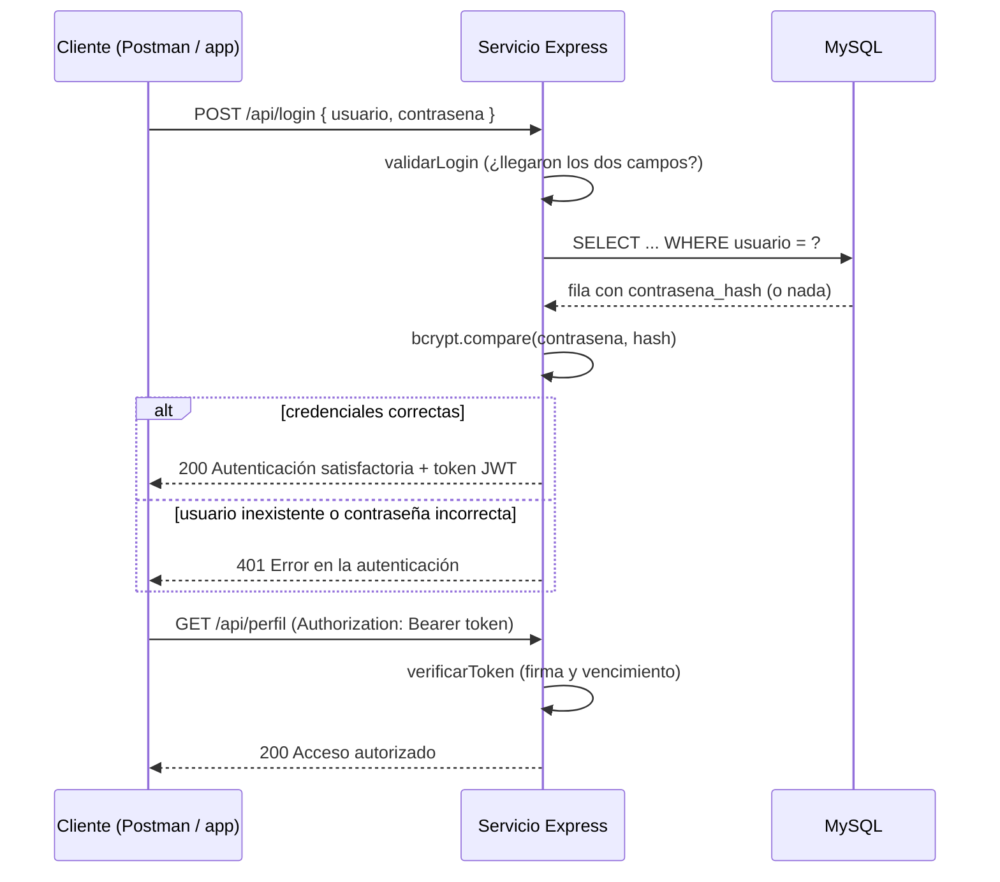

# Servicio web de autenticación (registro e inicio de sesión)

**Evidencia:** GA7-220501096-AA5-EV01 – Diseño y desarrollo de servicios web – caso
**Aprendiz:** Sergio Andrés Herrera Castro · Ficha 3186588
**Programa:** Tecnología en Análisis y Desarrollo de Software – SENA

Servicio web REST que permite **registrar** un usuario y **iniciar sesión**. Si el usuario y la contraseña son correctos, responde _"Autenticación satisfactoria"_ y entrega un **token JWT**; si no, responde _"Error en la autenticación"_. Incluye una ruta protegida (`/api/perfil`) que solo responde a quien envía un token válido.

## 1. Diseño del servicio

### 1.1 Contrato (qué recibe y qué devuelve)

| Método y ruta        | Recibe                                     | Éxito                                                        | Errores                                                                            |
| -------------------- | ------------------------------------------ | ------------------------------------------------------------ | ---------------------------------------------------------------------------------- |
| `POST /api/registro` | JSON `{ "usuario", "contrasena" }`         | **201** `Usuario registrado correctamente`                   | **400** datos inválidos (con `detalles`) · **409** `El usuario ya está registrado` |
| `POST /api/login`    | JSON `{ "usuario", "contrasena" }`         | **200** `Autenticación satisfactoria` + `token` + `expiraEn` | **400** faltan datos · **401** `Error en la autenticación`                         |
| `GET /api/perfil`    | Encabezado `Authorization: Bearer <token>` | **200** `Acceso autorizado` + datos del usuario              | **401** sin token · token inválido · sesión expirada                               |
| `GET /api`           | —                                          | **200** lista de rutas disponibles                           | —                                                                                  |

Ejemplo de respuesta de un inicio de sesión correcto:

```json
{
  "mensaje": "Autenticación satisfactoria",
  "token": "eyJhbGciOiJIUzI1NiIsInR5cCI6IkpXVCJ9.eyJzdWIiOiIzIiwidXN1YXJpbyI6...",
  "tipoToken": "Bearer",
  "expiraEn": "1h",
  "usuario": { "id": 3, "usuario": "sergio.herrera" }
}
```

### 1.2 Reglas de validación (registro)

- **Usuario:** de 4 a 30 caracteres; letras sin tilde, números, punto (`.`) o guion bajo (`_`). Se guarda en minúsculas, así `Sergio` y `sergio` son el mismo usuario.
- **Contraseña:** de 8 a 72 caracteres, con al menos una letra y un número.

En el inicio de sesión solo se revisa que lleguen los dos campos, para no dar pistas sobre las reglas a quien intenta adivinar contraseñas.

### 1.3 Flujo del inicio de sesión



### 1.4 Base de datos

Tabla `usuarios` (script `database/001_usuarios.sql`):

| Columna           | Tipo                       | Descripción                                       |
| ----------------- | -------------------------- | ------------------------------------------------- |
| `id`              | INT UNSIGNED, PK, AUTO_INC | Identificador                                     |
| `usuario`         | VARCHAR(30), UNIQUE        | Nombre de usuario (en minúsculas)                 |
| `contrasena_hash` | CHAR(60)                   | Contraseña cifrada con bcrypt. Nunca la original. |
| `fecha_creacion`  | DATETIME                   | Fecha de registro                                 |

### 1.5 Decisiones de seguridad

| Decisión                                                     | Por qué                                                                                                              |
| ------------------------------------------------------------ | -------------------------------------------------------------------------------------------------------------------- |
| Contraseñas con **bcrypt** (10 rondas)                       | Se guarda un hash de una sola vía con sal aleatoria. Si alguien roba la base de datos, no obtiene las contraseñas.   |
| **Mismo mensaje** para usuario inexistente y contraseña mala | Evita que un atacante descubra qué usuarios existen (enumeración de usuarios).                                       |
| **Mismo tiempo** de respuesta en ambos casos                 | Si el usuario no existe, igual se compara contra un hash de relleno, para que el tiempo de respuesta no delate nada. |
| **POST** para enviar credenciales                            | Con GET la contraseña quedaría en la URL, el historial y los registros del servidor.                                 |
| Consultas **parametrizadas** (`?`)                           | Evitan la inyección SQL.                                                                                             |
| **JWT** firmado con un secreto del `.env`                    | El cliente demuestra que ya inició sesión sin enviar su contraseña otra vez. El token vence (1 hora por defecto).    |
| `.env` fuera de GitHub                                       | Las claves de MySQL y el secreto JWT nunca se publican.                                                              |
| Límite de 10 KB en el cuerpo y sin `x-powered-by`            | Reduce abusos y no revela la tecnología del servidor.                                                                |

## 2. Tecnologías

Node.js 20+, Express 5, MySQL 8 (`mysql2`), `bcryptjs`, `jsonwebtoken`, `dotenv`. Estándar de código con ESLint, Prettier y EditorConfig. Pruebas con `node:test` (incluido en Node.js).

## 3. Instalación y uso

```bash
# 1. Instalar dependencias
npm install

# 2. Crear la base de datos: ejecutar database/001_usuarios.sql en MySQL Workbench

# 3. Configurar: copiar .env.example como .env y completar la contraseña de MySQL y JWT_SECRETO

# 4. Iniciar el servicio
npm start          # o "npm run dev" para que se reinicie solo al guardar cambios
```

El servicio queda en `http://localhost:4000/api`.

| Comando          | Para qué sirve                                |
| ---------------- | --------------------------------------------- |
| `npm start`      | Inicia el servicio                            |
| `npm run dev`    | Inicia y se reinicia solo al guardar archivos |
| `npm test`       | Ejecuta las 11 pruebas automáticas            |
| `npm run lint`   | Revisa el código con ESLint                   |
| `npm run format` | Da formato al código con Prettier             |

## 4. Pruebas

- **Manuales:** `pruebas/autenticacion.http` tiene 10 peticiones listas para la extensión **REST Client** de VS Code (o para copiarlas en Postman). La petición 8 usa automáticamente el token del inicio de sesión.
- **Automáticas:** `npm test` comprueba registro, usuario repetido, datos inválidos, contraseña cifrada en la base de datos, inicio de sesión correcto e incorrecto, mismo mensaje para usuario inexistente, ruta protegida con token válido, sin token, falso y vencido, JSON mal escrito y ruta inexistente.

```
✔ registro correcto responde 201 y no devuelve la contraseña
✔ la contraseña se guarda cifrada con bcrypt, nunca en texto plano
✔ registrar el mismo usuario (aunque cambien mayúsculas) responde 409
✔ registro con datos inválidos responde 400 con la lista de errores
✔ inicio de sesión correcto responde 200, autenticación satisfactoria y token
✔ contraseña incorrecta responde 401, error en la autenticación
✔ usuario inexistente responde exactamente lo mismo que contraseña incorrecta
✔ inicio de sesión sin datos responde 400
✔ ruta protegida: con token válido responde 200 con el perfil
✔ ruta protegida: sin token, token falso o token vencido responden 401
✔ JSON mal escrito responde 400 y una ruta inexistente responde 404
```

## 5. Estructura

```
servicio-autenticacion/
├── src/
│   ├── server.js                     Pone a escuchar el servicio
│   ├── app.js                        Configura Express, rutas y errores
│   ├── config/env.js                 Lee y revisa las variables del .env
│   ├── config/db.js                  Pool de conexiones a MySQL
│   ├── routes/authRoutes.js          /registro, /login, /perfil
│   ├── controllers/authController.js Lógica de registro, login y perfil
│   ├── models/usuarioModel.js        Consultas SQL a la tabla usuarios
│   ├── validators/authValidator.js   Reglas de usuario y contraseña
│   ├── middlewares/verificarToken.js Protege rutas con JWT
│   ├── middlewares/manejarErrores.js Convierte errores en respuestas JSON
│   └── utils/AppError.js · token.js  Error con código HTTP · crear/verificar JWT
├── database/001_usuarios.sql         Crea la base y la tabla
├── pruebas/autenticacion.http        Pruebas manuales (REST Client)
├── pruebas/autenticacion.test.js     Pruebas automáticas (npm test)
├── .env.example · .gitignore · .editorconfig · .prettierrc.json · eslint.config.js
└── package.json
```

## 6. Estándares de codificación

- Nombres en español, igual que el proyecto Baby Saraí: camelCase para variables y funciones (`iniciarSesion`), PascalCase para clases (`AppError`), MAYÚSCULAS para constantes (`MENSAJE_ERROR_LOGIN`), snake_case en MySQL (`contrasena_hash`).
- Cada archivo inicia con un comentario de su propósito y las funciones llevan JSDoc.
- Arquitectura por capas: rutas → controlador → validador / modelo. Errores centralizados en un middleware.
- `npm run lint` termina sin errores.

## 7. Repositorio

https://github.com/Sergio8526/servicio-autenticacion
